

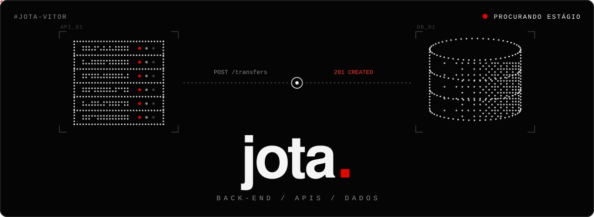

 

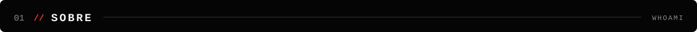

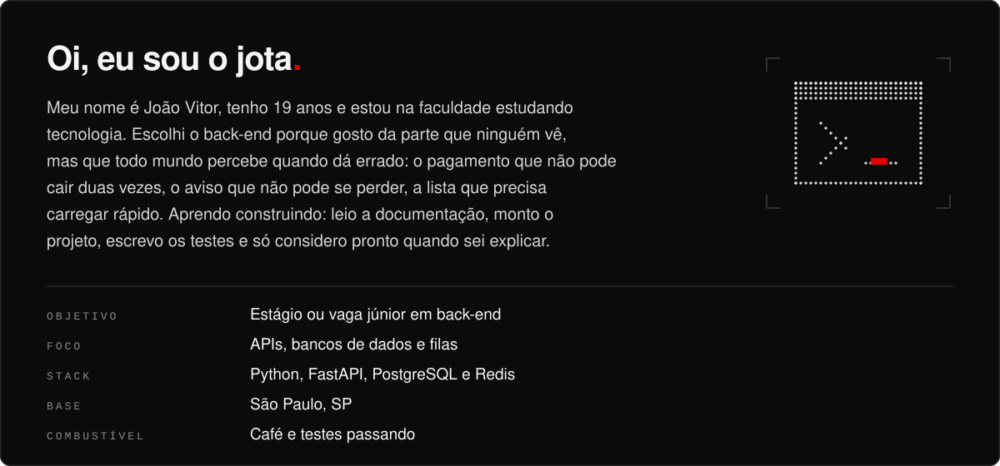

  

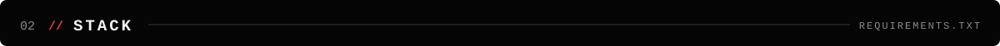

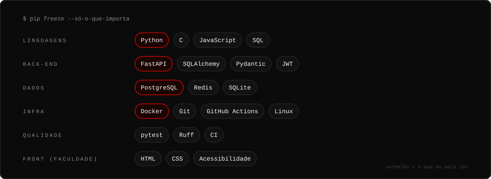

  

<a href="https://github.com/jota-vitor/ledger-api">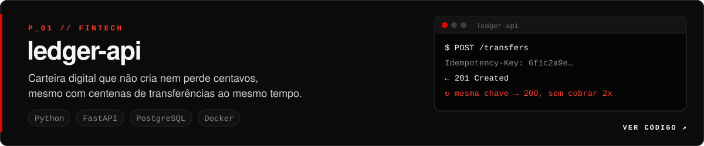</a>

<a href="https://github.com/jota-vitor/webhook-relay">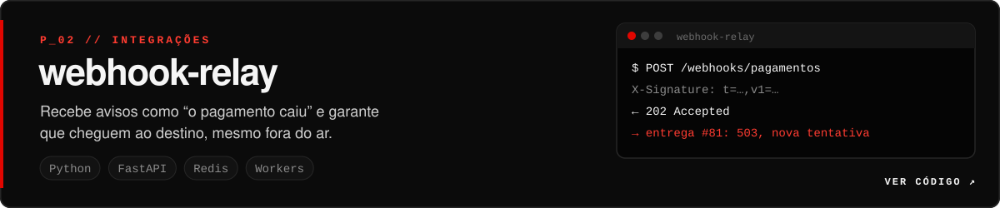</a>

<a href="https://github.com/jota-vitor/taskflow-api">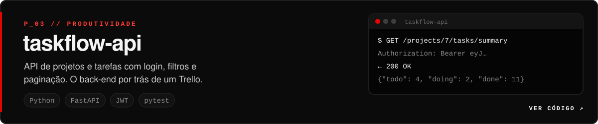</a>

**Da faculdade:** **ReCircuito**, um site sobre descarte correto de lixo eletrônico, feito em HTML, CSS e JavaScript com atenção à acessibilidade. E um **sistema acadêmico em C**, com cadastro de até 100 alunos, notas, relatório e média da turma.

 

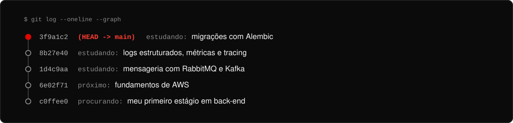

  

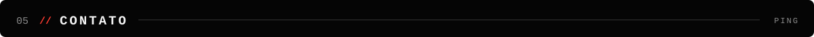

<a href="mailto:joaotatanjo@gmail.com">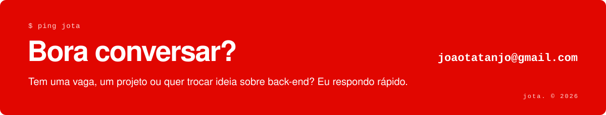</a>

